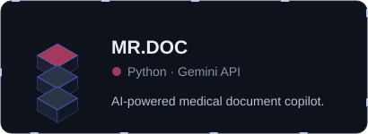

B.Tech CSE (AI &amp; ML) student exploring Python, AI/ML, and web development.

### Featured project

**MR.DOC** is my featured project: a medical document assistant that turns records, lab reports, and prescriptions into clear, multilingual explanations.

### Stack

### Projects

| Project | What it explores | Stack |
| :-- | :-- | :-- |
| [MR.DOC](https://github.com/KARTHIKEYA-BODA/MR.DOC) | Medical document analysis and multilingual explanations. | Python, JavaScript, Gemini API |
| [RAIL_FLOW](https://github.com/KARTHIKEYA-BODA/RAIL_FLOW) | Railway disruption planning and decision support. | React, TypeScript, FastAPI, OR-Tools |
| [CLASS_HUB](https://github.com/KARTHIKEYA-BODA/CLASS_HUB) | Classroom tools for attendance, assignments, notices, and records. | HTML, CSS, JavaScript, Node.js, MySQL |
| [bubble-sort-visualizer](https://github.com/KARTHIKEYA-BODA/bubble-sort-visualizer) | 3D animation of a bubble sort execution. | TypeScript, React, Remotion, Three.js |
| [DSA_PROBLEMS](https://github.com/KARTHIKEYA-BODA/DSA_PROBLEMS) | Python implementations of data structures and algorithms. | Python |

### GitHub stats

<a href="https://www.linkedin.com/in/karthikeya-boda-a24495381/">LinkedIn</a> &nbsp; · &nbsp; <a href="https://github.com/KARTHIKEYA-BODA?tab=repositories">All repositories</a>

