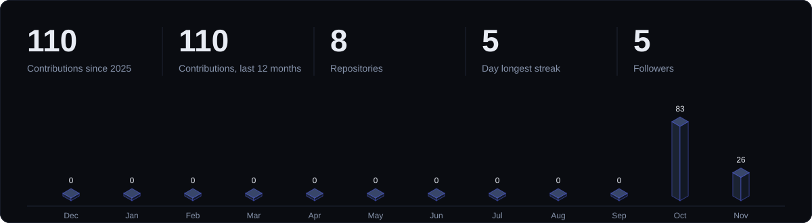

<p align="center"></p>

```text
> SYSTEM ONLINE
> AI / ML  ·  SOFTWARE  ·  WEB
```

### [01] IDENTITY

```text
$ who_am_i     Karthikeya Boda
$ role       B.Tech CSE (AI & ML) student
$ focus      AI/ML, Python and web development
$ learning   Data structures and algorithms
```

### [02] STACK

```text
FRONTEND    HTML  ·  CSS  ·  JavaScript  ·  TypeScript  ·  React
BACKEND     Python  ·  Node.js  ·  Express  ·  FastAPI
DATA / ML   SQL  ·  MySQL  ·  OR-Tools  ·  Gemini API
TOOLS       Git  ·  GitHub  ·  Remotion  ·  Three.js
```

### [03] BUILDS

| Project | What it explores | Stack |
| :-- | :-- | :-- |
| [RAIL_FLOW](https://github.com/KARTHIKEYA-BODA/RAIL_FLOW) | Simulation prototype for railway disruption planning and decision support. | React, TypeScript, FastAPI, OR-Tools |
| [MR.DOC](https://github.com/KARTHIKEYA-BODA/MR.DOC) | Prototype that interprets medical documents and presents multilingual explanations. | Python, JavaScript, Gemini API |
| [CLASS_HUB](https://github.com/KARTHIKEYA-BODA/CLASS_HUB) | Classroom platform for attendance, assignments, notices and student records. | HTML, CSS, JavaScript, Node.js, MySQL |
| [bubble-sort-visualizer](https://github.com/KARTHIKEYA-BODA/bubble-sort-visualizer) | A 3D video animation that follows a bubble sort execution. | TypeScript, React, Remotion, Three.js |
| [DSA_PROBLEMS](https://github.com/KARTHIKEYA-BODA/DSA_PROBLEMS) | Python implementations of data structures and algorithm problems. | Python |

### [04] STATUS

```text
EXPLORING   AI/ML, web development and algorithms
```



### [05] CONTACT

[LINKEDIN ↗](https://www.linkedin.com/in/karthikeya-boda-a24495381/) &nbsp; · &nbsp; [GITHUB ↗](https://github.com/KARTHIKEYA-BODA)
